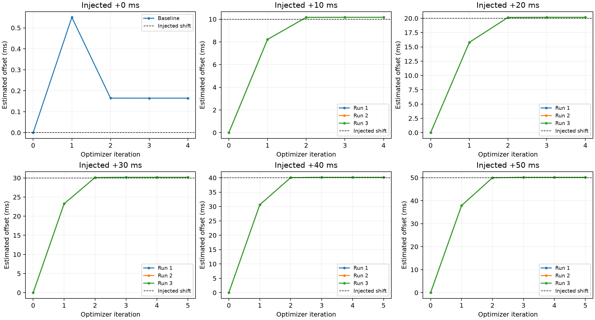
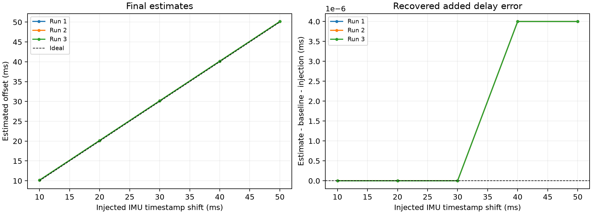

# TUM VI 人为时间延迟实验

2026-11-12，在 Apple Silicon Mac 的 Ubuntu 20.04 ARM64 Docker 容器中完成。对 10、20、30、40、50 ms 五种延迟各独立运行三次，共 15 次；另做一次 0 ms 参考。16 次均正常退出、报告收敛，所有优化尝试均被接受。

## 实验方法

- 数据：已下载的完整 `dataset-calib-imu1_512_16.bag`，1,038 组双目图像，`--skip-images 1`，标定板 `data/aprilgrid_6x6.json`。
- 注入方法：在读取 bag 时令 `t_imu_used = t_imu_original + injected_ms`，相机时间戳不变，原始 bag 不变。输出 offset 的约定为 `t_camera + estimated_offset ≈ t_imu_used`。
- 所有运行从相同的相机标定、角点和相机初始位姿缓存开始。缓存仅包含图像角点和视觉位姿，不包含上一次 IMU 优化结果；每次启动独立进程，从 0 ms 的待估计时间偏移重新优化。
- 固定参数：陀螺仪噪声标准差 `0.000282`，加速度计噪声标准差 `0.016`；其余使用现有默认值，包括优化时间偏移、不优化相机内参。无额外随机扰动。
- 收敛条件沿用源码的 `max_inc < 1e-4`，其中 `max_inc` 是所有优化状态的最大增量，并非专门的时间偏移误差阈值。
- 只增加 CLI 延迟参数、实验标记和时间偏移打印精度，未改变优化算法。默认人为注入值仍为 50 ms。

输入文件大小与 SHA-256、相机标定副本、程序源码哈希、Docker 镜像 ID、每次完整命令及进程退出状态分别保存在 `manifest.json` 和 `camera_calibration.json`。`source_commit` 是运行前的仓库提交，另列出的源码哈希对应本次实验改动。

## 最终估计

以下单位均为 ms，保留 6 位小数（日志以秒输出 9 位小数）：

| 人为注入 | 第 1 次 | 第 2 次 | 第 3 次 | 均值 | 相对注入值的差值 | 收敛轮数 |
|---:|---:|---:|---:|---:|---:|---:|
| 10 | 10.164550 | 10.164550 | 10.164550 | 10.164550 | +0.164550 | 4 |
| 20 | 20.164550 | 20.164550 | 20.164550 | 20.164550 | +0.164550 | 4 |
| 30 | 30.164550 | 30.164550 | 30.164550 | 30.164550 | +0.164550 | 5 |
| 40 | 40.164554 | 40.164554 | 40.164554 | 40.164554 | +0.164554 | 5 |
| 50 | 50.164554 | 50.164554 | 50.164554 | 50.164554 | +0.164554 | 5 |

三次重复的最终估计在打印分辨率内一致，各组样本标准差为 0。0 ms 参考运行的估计为 **0.164550 ms**，所以表中的约 +0.16455 ms 不能全部解释为人为延迟恢复误差，它包含对原始数据偏移的估计。

用 `estimated_offset - baseline_offset` 估计人为增加的延迟，得到：

| 人为注入 / ms | 扣除 0 ms 参考后的估计 / ms | 相对注入量差值 / ms |
|---:|---:|---:|
| 10 | 10.000000 | 0.000000 |
| 20 | 20.000000 | 0.000000 |
| 30 | 30.000000 | 0.000000 |
| 40 | 40.000004 | +0.000004 |
| 50 | 50.000004 | +0.000004 |

这说明本次数据和初始化条件下，对人为时间戳平移的估计具有很强的一致性。参考偏移本身也是估计值，且三次使用同一份数据与相同初始化；这些结果不能证明真实传感器时差具有纳秒级绝对精度，也不代表跨数据集、不同噪声或初始化下的鲁棒性。

15 次主实验的平均重投影误差在 `0.0869344–0.0869407` 像素之间；日志记录的优化循环耗时为 `71–106 ms`。独立进程的主机侧总耗时为 `0.596–0.675 s`，包括容器执行、bag 索引读取、缓存加载、初始化和优化，不包括角点重新检测；不能与冷启动全流程耗时混用。

## 时间延迟收敛过程



第 0 轮是优化前的 0 ms 初值。三个重复的曲线在当前显示尺度下重合，图中最上层通常只看到第 3 次的绿色曲线。虚线标记人为注入量，不包含原始数据的参考偏移。

下面是第 1 次的逐轮估计，单位为 ms；全部三次的每轮值均在 `convergence.csv` 中：

| 轮次 | 注入 10 ms | 注入 20 ms | 注入 30 ms | 注入 40 ms | 注入 50 ms |
|---:|---:|---:|---:|---:|---:|
| 0 | 0.000000 | 0.000000 | 0.000000 | 0.000000 | 0.000000 |
| 1 | 8.216213 | 15.783713 | 23.249962 | 30.613284 | 37.888412 |
| 2 | 10.159611 | 20.143466 | 30.119308 | 40.080632 | 50.014767 |
| 3 | 10.164620 | 20.164846 | 30.165246 | 40.165759 | 50.166295 |
| 4 | 10.164550 | 20.164550 | 30.164550 | 40.164555 | 50.164556 |
| 5 | 已收敛 | 已收敛 | 30.164550 | 40.164554 | 50.164554 |



## 文件说明

- `logs/*.log`：16 个进程各自的完整原始 stdout/stderr，包含每轮估计、接受状态、目标函数、外参、误差和耗时。
- `convergence.csv`：89 条记录，含初值、重复编号、注入量、尝试编号、外层迭代编号、接受/拒绝状态、偏移估计、目标函数、累计优化阶段时间。`optimizer_elapsed_ms` 来自日志中每轮 `setup_time + iter_time` 的累加；原日志各阶段时间按毫秒取整，因此与总优化循环计时有少量差异。
- `runs.csv`：16 次运行的最终估计、两种差值、收敛轮数、拒绝步数、耗时及平均重投影误差；`repeat=0` 是单次 0 ms 参考。
- `summary.csv`：五种注入延迟的三次估计、均值、样本标准差，以及相对注入值/扣除参考后的差值。CSV 使用半角逗号。
- `convergence.png/.pdf`、`estimation.png/.pdf`：可直接查看或导出的曲线图。

## 复现

先按照 [Docker 说明](../../doc/DockerMac.md) 准备并启动容器。重编译本次改动：

```sh
docker compose exec calib cmake --build build/docker --parallel 2 --target basalt_calibrate_imu
```

单次运行时，在原 IMU 命令后增加 `--time-offset-ms 10`。该选项也接受 `10 20 30 40 50` 列表，但本报告通过独立进程完成每次重复。

批处理依赖 Python 3.11+ 与 Matplotlib。项目原始 `build/results/` 中需保留相机标定及 `calib-cam-imu` 角点、初始位姿缓存；脚本会复制到临时工作目录，并在完成后清理临时副本，原始结果不变。

```sh
python3 -m venv build/plot-env
build/plot-env/bin/python -m pip install matplotlib
build/plot-env/bin/python scripts/time_delay_experiments.py experiments/time_delay_rerun
```

输出目录必须不存在，脚本拒绝覆盖已有实验。脚本会检查进程成功、程序确认的注入值、正常收敛和数值有效性。日志解析测试：

```sh
PYTHONDONTWRITEBYTECODE=1 python3 -m unittest discover -s test -p 'test_time_delay_experiments.py' -v
```
