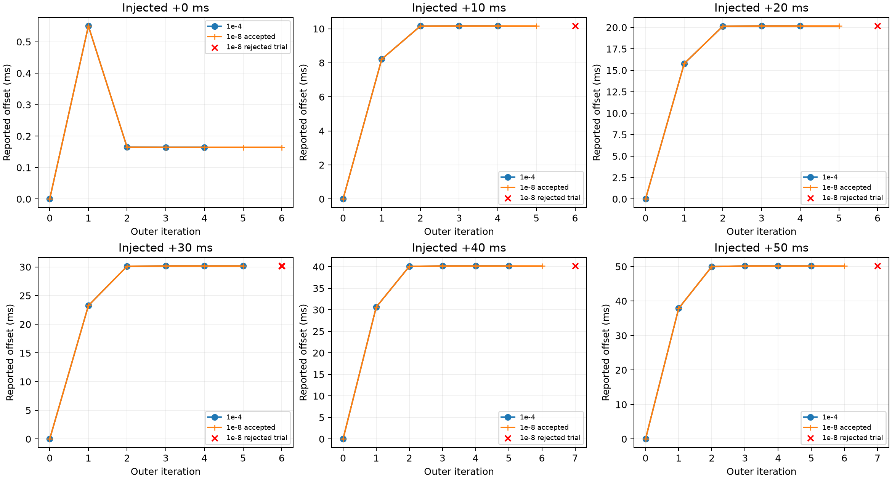
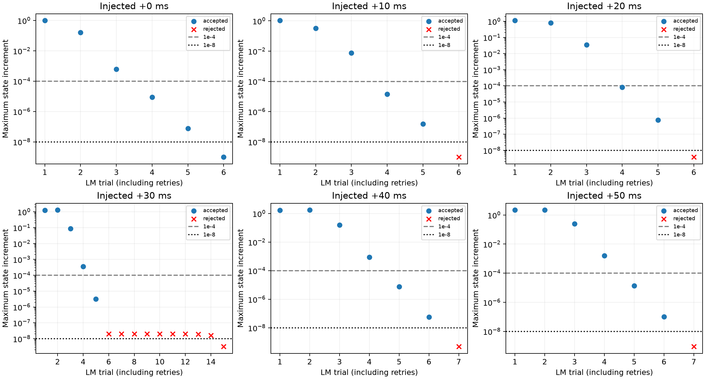

# 停止阈值 1e-8 对照实验

2026-11-12，将 `CamImuCalib` 的 `stop_thresh` 从 `1e-4` 改为 `1e-8`，重新构建并对 10、20、30、40、50 ms 各运行一次，另跑一次 0 ms 参考。沿用 [前次实验](../time_delay_2026-11-12/README.md) 的完整数据、相机标定、视觉角点和初始位姿；每次启动独立进程，时间偏移从 0 ms 开始优化。

**结果：外层迭代从 4–5 轮增加到 6–7 轮，最后接受步的时间偏移估计在 1 ns 打印分辨率内未改变。但是，五组人为注入实验均在拒绝步后报告收敛，因此不能将它们视作已验证的严格阈值收敛。**

## 结果对比

下表中的 `1e-8` 估计取最后一个接受步，不取被拒绝的候选值。旧结果取前次第 1 次重复；三次旧结果本身一致。所有偏移估计的单位为 ms。

| 注入量 | 1e-4 估计 | 1e-8 最后接受步估计 | 1e-4 轮数 | 1e-8 外层轮数 | 1e-8 接受/拒绝尝试数 | 最后一次最大状态增量 |
|---:|---:|---:|---:|---:|---:|---:|
| 0（参考） | 0.164550 | 0.164550 | 4 | 6 | 6 / 0 | 9.85910e-10 |
| 10 | 10.164550 | 10.164550 | 4 | 6 | 5 / 1 | 9.85911e-10 |
| 20 | 20.164550 | 20.164550 | 4 | 6 | 5 / 1 | 3.82965e-9 |
| 30 | 30.164550 | 30.164550 | 5 | 6 | 5 / 10 | 3.20278e-9 |
| 40 | 40.164554 | 40.164554 | 5 | 7 | 6 / 1 | 4.85976e-10 |
| 50 | 50.164554 | 50.164554 | 5 | 7 | 6 / 1 | 8.96623e-10 |

30 ms 组的最后一个外层迭代内进行了 10 次阻尼重试，全部被拒绝；所以“6 个外层迭代”不是“总共只求解 6 次方程”。该组总共有 15 次求解尝试。

本次五组日志报告的优化循环耗时为 112–184 ms，含缓存加载等步骤的主机侧进程总耗时为 0.658–0.721 s。这里只是本次诊断运行的计时，不据此推断精度提升。

## 收敛曲线



蓝线为旧阈值结果，橙线为严格阈值的接受步，红叉为严格阈值的拒绝候选。30 ms 组的 10 个拒绝尝试在外层迭代图上重叠；按尝试编号展开后见下图。



横轴包括阻尼重试，纵轴为各次求解的最大状态增量，对数刻度。0 ms 参考在第 6 次接受步后正常停止；其余五组都是最终拒绝步的增量落在 `1e-8` 以下后退出。

## 为什么将五组结果标记为未验证

源码在 `include/basalt/optimization/spline_optimize.h` 中先执行：

```cpp
if (max_inc < stop_thresh) converged = true;
```

随后才更新状态、重新计算误差、决定接受或拒绝该步。拒绝分支没有清除 `converged`，因此可能出现 `[REJECTED]` 紧接 `[CONVERGED]` 的日志。

另外，拒绝分支只恢复了一部分状态；`applyInc()` 累加的时间偏移、`reinit()` 修改的时间戳/离散状态及预积分约束等没有完整回滚。这是此次保持原优化算法进行诊断时保留的上游问题，不能仅凭程序打印“收敛”认定严格阈值验证通过。小步长和舍入也可能使改善量很小；本实验没有单独判断每次拒绝的数值原因。

实际证据见六份原始日志，其中：

- `logs/delay_10ms_run_1.log`：第 6 次尝试，`max_inc=9.85911e-10`，状态为 `REJECTED`，随后输出 `CONVERGED`。
- `logs/delay_30ms_run_1.log`：最后一轮的最大增量从约 `2.06139e-8` 经阻尼重试降到 `3.20278e-9`，10 次尝试全部拒绝，随后输出 `CONVERGED`。
- `logs/delay_00ms_run_0.log`：6 次均接受，无此拒绝步问题。

因此，本次支持的结论是：**前次 4–5 轮时的时间偏移已经非常稳定；提高停止阈值严格程度会多做迭代，但也触发了现有实现中接受/拒绝和收敛标志之间的问题。** 没有修复优化器或验证绝对时间标定精度。

## 文件与复现

- `logs/`：最终六次完整原始日志。
- `convergence.csv`：53 条初值及尝试记录，保留全部接受/拒绝状态；30 ms 组的阻尼重试均单独记录。
- `runs.csv` / `summary.csv`：最后接受步估计、轮数和诊断状态。`validated=False` 表示出现拒绝步，不能当作正常验证通过的估计；`sample_std_ms` 留空，因为每组只有一次。
- `comparison.csv`：新旧阈值、轮数、接受/拒绝次数及最终最大增量对照。
- `manifest.json`：输入与源码 SHA-256、镜像 ID、执行命令和退出码；`camera_calibration.json` 为相同的相机标定输入副本。
- `convergence.*` / `estimation.*`：通用批处理图，其中收敛图只画接受步；查看拒绝候选时请使用上面的 `threshold_comparison.*` / `step_size.*`。

批处理默认遇到拒绝步就停止；先导运行触发该保护后，完整六组运行显式使用诊断开关。这不改变优化算法，只允许保存未通过验证的结果并标记状态：

```sh
docker compose exec calib cmake --build build/docker --parallel 2 --target basalt_calibrate_imu
build/plot-env/bin/python scripts/time_delay_experiments.py experiments/threshold_1e8_rerun \
  --repeats 1 --record-rejected-trials
```

上面的命令需要 Python/Matplotlib 环境，且当前源码中 `stop_thresh` 为 `1e-8`。脚本仍默认每组重复三次，本次用 `--repeats 1`。相机标定和缓存的准备方法沿用 [Docker 说明](../../doc/DockerMac.md)。

基于已保存记录重新生成对比表和两张诊断图：

```sh
build/plot-env/bin/python experiments/time_delay_2026-11-12_threshold_1e-8/compare_thresholds.py
```
